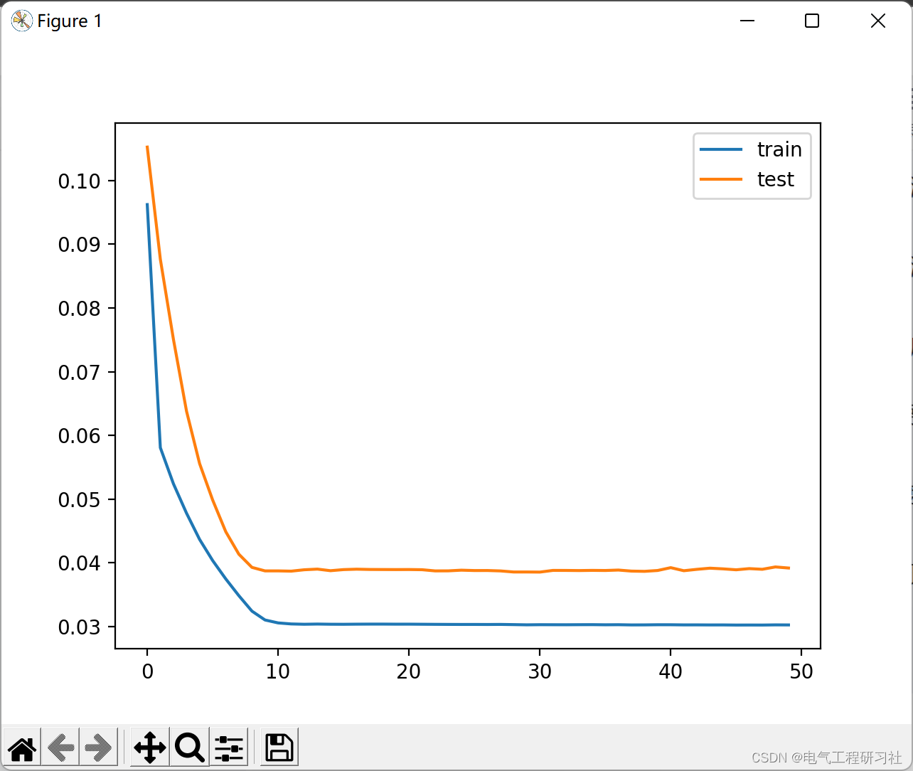

# Deep Learning-Based Multi-Feature Electricity Load Forecasting (Python Code Implementation)

Deep Learning-Based Multi-Feature Electricity Load Forecasting (Python Code Implementation)
​  
1. Overview
Electricity load forecasting can be divided into coarse-grained prediction and fine-grained prediction according to the level of detail. The prediction of roughness is to train the energy load data of the whole period and then make a prediction. The fineness prediction should consider the seasonal and time-period impact factors of electrical energy load.
When conducting crude prediction of urban residents' electricity load, the accuracy of the following three situations should be considered:
Predict the power load at this moment using the previous moment's energy consumption (power), temperature (temperature), humidity (humidity), and wind speed.
Predict the power load at this moment using the previous moment's power load (power), current temperature (temperature), humidity (humidity), and wind speed.
Predict the power load at this moment using the previous several moments' energy consumption (power), temperature (temperature), humidity (humidity), and wind speed.
When conducting detailed forecasts of urban residents' electricity load, in addition to the considerations mentioned above, factors such as seasonality and time cycles should also be taken into account:
Electricity load often has a periodicity, and the difference in electricity consumption between summer, winter, transition season (spring and autumn) is usually large. Therefore, it can be considered to separate prediction when forecasting.
Predictions can be made at various seasons, and we can also divide them into days, weeks, and months.
2 Results Display
​  
3 Python code implementation
This article only displays a portion of the code, the full code can be found in:
# invert scaling for forecast\ninv_yhat = concatenate((yhat, test_X[:, 1:]), axis=1)\ninv_yhat = scaler.inverse_transform(inv_yhat)\ninv_yhat = inv_yhat[:, 0]\n# invert scaling for actual\ntest_y = test_y.reshape((len(test_y), 1))\ninv_y = concatenate((test_y, test_X[:, 1:]), axis=1)\ninv_y = scaler.inverse_transform(inv_y)\ninv_y = inv_y[:, 0]\n# calculate RMSE\nrmse = sqrt(mean_squared_error(inv_y, inv_yhat))\nprint('Test RMSE: %.3f' % rmse)\n\n# calculate MAPE\nmape = mean_absolute_percentage_error(inv_y, inv_yhat)\nprint('Test mape: %.3f' % mape)\n  
​  

## Images

<!-- PAYMENT_BLOCK -->

## Get this dataset

- Payment link (Stripe): [Buy now](https://buy.stripe.com/3cs8yP7sY87d0vu9AB)
- Payment QR code: 

<!-- /PAYMENT_BLOCK -->
